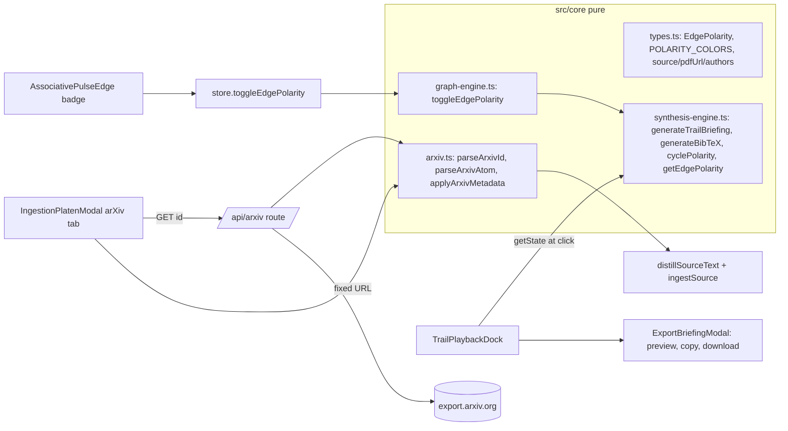

# Technical Design: Research Intelligence & Synthesis Suite

## 1. Architecture Overview

- `src/core/types.ts`: `EdgePolarity`, `POLARITY_COLORS`, optional `polarity` on `AssociativeEdgeData`, optional `source`, `pdfUrl`, `authors` on `MemexNodeData`.
- `src/core/synthesis-engine.ts`: briefing, BibTeX, polarity helpers, `briefingFilename`.
- `src/core/arxiv.ts`: id parsing, Atom extraction, response guard, card stamping.
- `src/core/graph-engine.ts`: pure `toggleEdgePolarity(state, edgeId)`.
- `src/store/useMemexStore.ts`: `toggleEdgePolarity(edgeId)` commits the pure result (one persist).
- `src/app/api/arxiv/route.ts`, `src/components/canvas/ExportBriefingModal.tsx`, `src/components/trails/TrailPlaybackDock.tsx`, `src/components/canvas/AssociativePulseEdge.tsx`, `src/components/canvas/IngestionPlatenModal.tsx`.

## 2. Data Schemas
```ts
type EdgePolarity = "supports" | "refutes" | "synthesizes";
// AssociativeEdgeData gains:  polarity?: EdgePolarity            (absent = supports)
// MemexNodeData gains:        source?: string; pdfUrl?: string; authors?: string[]
interface BriefingOptions { generatedDate?: string }               // YYYY-MM-DD
interface ArxivPaper { title: string; authors: string[]; year?: number;
                       abstract: string; arxivId: string; pdfUrl: string }
type ArxivParseResult = { kind: "ok"; paper: ArxivPaper } | { kind: "not-found" } | { kind: "malformed" };
```
All new fields are optional and are never written as `null`, so existing saves, export/import and deterministic JSON (`serializeGraph` key order follows construction order) keep working. `deserializeGraph` does not validate polarity: `getEdgePolarity` and `cyclePolarity` treat any other value as `supports`.

## 3. Synthesis Template
```
---
title: "<trail.title>"          (yamlQuote: JSON escaping plus \u escapes for U+007F-U+009F, U+2028/9, U+FEFF)
generatedDate: "<options.generatedDate | date of trail.createdAt>"
trailId: "<trail.id>"
cardCount: <resolved cards>
missingCards: <n>               (only when n > 0)
---
# Executive Research Briefing
**Trail:** <title>
## Thematic Arc & Thesis
## Chronological Lineage
## Empirical Evidence & Quotations
## Dialectical Tensions
## Archival Bibliography
```
- **Resolution.** Trail node IDs are deduplicated in order and looked up by card `id`; unknown IDs count toward `missingCards`.
- **Thesis.** With cards `n`, years `lo..hi` from `getEventYear`, and the 3 most frequent tags (ties alphabetical): `From {lo} to {hi}, {n} cards connect {a, b and c}.` Variants: one year (`In {y}, ...`), no years (`{n} undated cards ...`), no tags (`form this trail`), one card (`covers`). Bullets add the first and last card, the composition by type, the counts of `refutes` and `synthesizes` edges inside the trail, and the trail's own description.
- **Lineage.** Per card: `### i. title`, archival ID and card ID as code spans, date, type, tags, source, the link to the next stop (polarity, origin, rationale, or "none recorded"), then the content as a block quote.
- **Evidence.** Quote and artifact cards with the same content block.
- **Tensions.** Real edges (no `discoveryId`) with `polarity === "refutes"` and both endpoints in the trail, deduplicated by id, ordered by source and target position in the trail, rendered `**A** (id) ≠ **B** (id)` with the rationale. None: `- None recorded: no "refutes" links connect cards in this trail.`
- **Bibliography.** `n. authors (year). Title. Source. url [Memex archival ID: id]`, using only fields the card holds. `pdfUrl` is printed only when it is an http(s) URL without whitespace or angle brackets.
- **Untrusted text.** Titles, tags and rationales pass through `singleLine`. Content is prefixed `> ` per line, which keeps it verbatim line by line and prevents injected headings, `---` rules or front matter. Titles and IDs are not Markdown-escaped, so they appear verbatim in the output.

### BibTeX
`@article` when `source` starts with `arXiv:` or matches `journal|transactions|review|letters|quarterly|monthly|magazine`; otherwise `@misc` (with `howpublished` when a source exists). Fields in order: `title = {{...}}`, `author`, `journal` (`arXiv preprint arXiv:<id>` for arXiv) or `howpublished`, `year`, `eprint`, `archivePrefix`, `url`, `note = {Memex archival ID: ...}`. `escapeBibTeX` maps `\` to `\textbackslash{}`, `^` to `\textasciicircum{}`, `~` to `\textasciitilde{}` and prefixes `{ } & % $ # _` with a backslash, so unescaped braces stay balanced. `url` percent-encodes `{ } \`.

## 4. Edge Polarity Styling (no SVG filters)
| Polarity | Stroke | Base line | Pulse | Badge |
|---|---|---|---|---|
| supports | origin color (`#FFB236` human, `#B388FF` ghost) | solid | forward, `memex-edge-pulse` | hidden; `→ SUPPORTS` on hover or selection |
| refutes | `#EF4444` | dashed `7 5` | reverse, `memex-edge-pulse-reverse` (dash offset -100 to 0) | always `≠ REFUTES` |
| synthesizes | `#B388FF` | solid | two pulses, the second delayed by half the period | always `⚡ SYNAPSE` |
- Glow stays a wide translucent stroke under the crisp 1px path. Pulses animate `stroke-dashoffset` through CSS; reduced-motion disables both pulse classes.
- Badges are framer-motion buttons: spring in and out (opacity, scale), `whileTap` scale, and a keyed inner span that re-springs when the polarity changes. Only `transform` and `opacity` animate.
- Placement: the badge sits at the bezier midpoint; the rationale pill is anchored 18px below it so they never overlap.
- **Ghost semantics.** Display edges derived from `GhostDiscovery` (they carry `discoveryId`) ignore polarity, keep their "⚡ X% SYNAPSE" pill (fully rounded, with a percentage, opens the inspector) and are not store edges, so `toggleEdgePolarity` cannot touch them. The polarity "⚡ SYNAPSE" badge is a square-cornered stamp with no percentage, only on real edges, and its `aria-label` is "Edge polarity: synthesizes. Activate to change to supports." versus "Ghost synapse, N percent confidence. Open inspector."
- Color rule: `supports` keeps the origin color so edges without polarity look exactly as before; `refutes` and `synthesizes` override the origin color. `#EF4444` is the one color outside the base palette, requested for tension.
- Trail dimming applies to the stroke group and to the badge container (`DIM_OPACITY`).

## 5. arXiv Proxy
`GET /api/arxiv?id=` in `src/app/api/arxiv/route.ts` (`await connection()` first, as the ghost route does; the build marks it dynamic under `cacheComponents`).
1. `parseArxivId(raw)`; invalid gives 400 (DOI-shaped input gets the DOI message). Nothing else is forwarded.
2. Per-IP limit of 12 requests per 60 seconds (in memory, `x-forwarded-for`), applied after validation so bad input costs nothing.
3. `fetch(buildArxivQueryUrl(id))` with `redirect: "manual"`, `cache: "no-store"`, `AbortController` at 10 seconds, `User-Agent: Memex-2/0.1 (...)`. `buildArxivQueryUrl` builds the URL from the constant base and `URLSearchParams({ id_list, max_results: "1" })` and throws unless the id is canonical.
4. The body is read through a stream and aborted past 512 KB (also checks `content-length`).
5. `parseArxivAtom` reads the first `<entry>`: title, author names, `published` year (1991 to 2100), summary, `<id>` and the `pdf` link. Entities are decoded in one pass (so `&amp;lt;` becomes `&lt;`), nested tags are removed, whitespace is collapsed, and numeric entities outside Unicode scalar range are left as text. A title of "Error", an `api/errors` id or a feed without entries is `not-found`. A pdf link that is not on arxiv.org is replaced by `https://arxiv.org/pdf/<id>`.
6. Status mapping: not-found 404, malformed 502, non-2xx or redirect or oversize or network error 502, abort 504, rate limit 429. Bodies are `{ error }` with fixed text. The response `arxivId` is the validated request id.
Security notes: no SSRF (one fixed host, no user string in the URL besides the validated id), no open redirect, no response passthrough, bounded time and memory, no secrets involved, `Cache-Control: no-store`.

Client (`IngestionPlatenModal`): `parseArxivId` runs first; DOI-shaped input shows the "not supported yet" message without a request. The fetch uses an `AbortController` stored in a ref, aborted on tab switch, a new resolve and unmount. The response passes `isArxivPaper` before use. Scan distills `title` and `abstract` with `distillSourceText`, then `applyArxivMetadata` stamps the cards before the single `ingestSource` call.

## 6. Correctness Properties (`fast-check`, 200 runs each)
File: `src/core/__tests__/synthesis.property.test.ts` (and `arxiv.test.ts`, `arxiv-route.test.ts`).
- **Property 1 (Briefing Coverage):** for any titles (including Markdown, YAML and Unicode characters), any trail subset, with or without refutes edges and missing ids, the briefing contains every listed card's archival ID, card ID and title, and has exactly the five fixed `## ` sections. For any trail title and id, the front matter parses back to the original values.
- **Property 2 (BibTeX Validity):** for any card input, `generateBibTeX` parses with a strict validator (entry type, key in `[A-Za-z0-9_:-]`, `name = {value}` fields, balanced unescaped braces), holds the escaped title and archival ID, and is deterministic.
- **Property 3 (Polarity Cycle):** `cyclePolarity` applied three times is the identity, it is a bijection on the three values, `undefined` maps to `refutes`; `toggleEdgePolarity` (pure and store) applies exactly one step to the targeted real edge, leaves other edges identical, ignores unknown ids, and survives export and import.
- Unit tests: id parsing (valid, invalid, URL forms, injection attempts), Atom fixture, error entry, entities, route validation and status mapping with a mocked `fetch`, hostile card text, empty and missing-card trails, and a snapshot of the demo seed briefing.

## 7. Limitations
DOI resolution is not built; the tab is labelled "arXiv / DOI" and DOI input gets a clear message. The briefing is extractive and states no claim beyond the cards. The rate limit is held in memory per server instance, so it resets on restart and is not shared between instances. BibTeX leaves non-ASCII characters as UTF-8. The briefing's lineage and evidence sections both print quote and artifact content.
