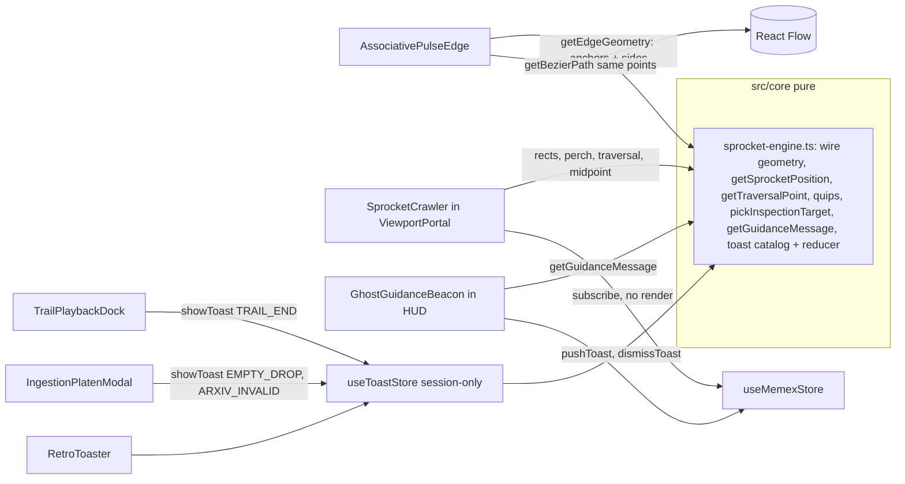
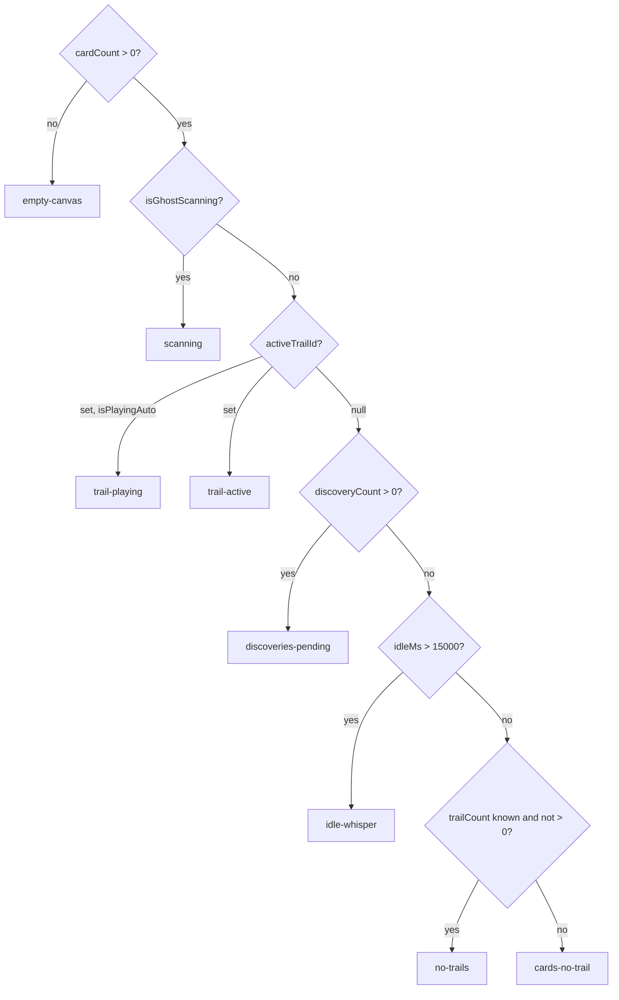

# Technical Design: The Ghost & Sprocket (UX Mischief & Guidance Suite)
## 1. Architecture Overview

- `src/core/sprocket-engine.ts`: pure and deterministic. Time, idle values and indices are arguments.
- `src/store/useToastStore.ts`: a separate zustand store for toasts. It is not part of `useMemexStore`, so toasts can never reach `persistGraph`, `exportJson` or hydration.
- `src/components/canvas/SprocketCrawler.tsx`, `GhostGuidanceBeacon.tsx`, `RetroToaster.tsx`: new UI, mounted in `MemexCanvas.tsx` (crawler inside `<ReactFlow>`, beacon inside the HUD card, toaster beside the drawer).
- Touched: `AssociativePulseEdge.tsx` (uses the shared geometry), `TrailPlaybackDock.tsx` (end-of-trail toast), `IngestionPlatenModal.tsx` (two toasts), `globals.css` (leg keyframes, reduced-motion rule).
## 2. Wire Geometry and Path Matching
`AssociativePulseEdge` used to compute its anchors inside the component. That logic now lives in the core and the component calls it:
1. `facingSides(source, target)`: horizontal when `|dx| / (sw + tw) >= |dy| / (sh + th)` (centre distances), then right/left or left/right by the sign of `dx`; otherwise bottom/top or top/bottom by the sign of `dy`.
2. `edgeAnchor(rect, side)`: the middle of that side.
3. `getEdgeGeometry(source, target)`: both anchors and both sides. The edge feeds these, with `curvature: EDGE_CURVATURE = 0.35`, to React Flow's `getBezierPath`, so the drawn path is unchanged.
4. `getBezierCurve` / `getEdgeCurve`: the four points `p0 p1 p2 p3` of the same cubic. The control points reproduce React Flow's rule exactly: for a side `s`, offset `o(d) = 0.5·d` when `d >= 0`, else `curvature · 25 · √(−d)`, where `d` is the signed distance from this anchor to the other along the side's axis (`right`: `x2 − x1`; `left`: `x1 − x2`; `bottom`: `y2 − y1`; `top`: `y1 − y2`). The control point moves out of the anchor along that side by `o(d)`.
5. `cubicBezierPoint(p0, p1, p2, p3, t)`: the Bernstein form `(1−t)³p0 + 3(1−t)²t·p1 + 3(1−t)t²·p2 + t³p3`, with `t` clamped to `[0, 1]` (NaN is 0) and exact end points at `t = 0` and `t = 1`. At `t = 0.5` it equals React Flow's `labelX/labelY`, which is where the edge's pill sits.

**Path-matching strategy.** Sprocket never reads the SVG path. It rebuilds the same four points from the two card rectangles with the same rules, and a property test compares them with the numbers parsed from React Flow's own `getBezierPath` output for random rectangles (`< 1e-6`), plus the label midpoint. If the edge and the engine ever diverge, that test fails.

**Which card rectangle.** `resolveCardRect(node)` uses the measured size, then `width`/`height`, then `style`, then the store's `DEFAULT_CARD_SIZE`, at `node.position` (cards have no parent, so position is absolute). The edge keeps its own pre-measurement fallback (`EDGE_FALLBACK_CARD_SIZE`, 280×160).

**Direction.** The stored edge may run from stop N+1 to stop N. `findWireDirection(edges, a, b)` returns `forward`, `reverse` or `none`. For `reverse`, the traversal samples the stored curve (`getSprocketPosition(to, from, 1 − t)`), which is the same line the edge draws. For `none`, it uses the curve an edge `from → to` would take.

**Traversal.** `getTraversalPoint(from, to, progress, direction)` splits progress into three parts: a hop from the source perch to the wire start (first 15%), the wire (70%, eased by the tween), and a hop from the wire end to the target perch (last 15%). Every result is clamped into the union box.

**Bounds.** `rectToBounds` accepts negative sizes (reversed rectangles) and replaces NaN with 0 and infinities with ±1e12. `getSprocketPosition(source, target, t)` samples the curve and applies `clampToBounds(point, unionOfRects(source, target))`. The curve's control points can bulge outside the cards, so the clamp is what guarantees the invariant. The perch lies on the card's top edge, inside its box, so hops stay inside too.

**Perch.** `getPerchPosition(rect)` = `(maxX − 48, minY)`: on the top edge, 48 px from the right corner. The breathing bob is a framer `y` keyframe on the sprite, not a coordinate change.
## 3. Sprocket Component
### 3.1 Rendering
- `ViewportPortal` places the sprite in flow coordinates. Its wrapper `motion.div` takes `x`, `y` and `opacity` motion values, `pointer-events: none`, `z-index: 1200` (above edge pills at 1000 to 1002, below modals at 2000). Only the `<button>` has `pointer-events: auto`, with `nopan nodrag nowheel`.
- Counter-scale: `useViewportStore(selectZoomScale)` returns `min(3, max(1, 1 / bucket))` with `bucket = max(0.25, round(zoom·4)/4)`. It changes only at quarter-zoom steps, so it is not a per-frame subscription. A spring animates `scale` around the sprite's foot.
- The component re-renders only on: perch card ID, active trail ID, active trail index, scanning flag, zoom step, and its own small state (mode, bubble, click count). Card drags change none of these.
### 3.2 Imperative controller
`createController` (module scope in the component file) owns the choreography. It writes motion values, keeps one current `Activity` (`traverse`, `relocate`, `reaction`), and every new activity stops the previous one first. A single `useMemexStore.subscribe` outside React calls `follow()` (stay on the perch while the card is dragged, ignored mid-activity), `validate()` (cancel a stale reaction) and detects scan end. `dispose()` stops animations and timers on unmount.

| Trigger | Action |
|---|---|
| First render with cards | `place()`: snap to the perch |
| `activeTrailIndex` ±1 in the same trail | `traverse(from, to)`: 150 ms wind-up, then `animate(0, 1, { duration: 0.65, ease: easeInOut })` (800 ms in all since Spec 07), each frame `getTraversalPoint`, then the landing rebound |
| Any other perch change (trail start/exit, jump, new card, card removed) | `relocate()`: spring `animate(0, 1, SPRING)` from the current point to the perch (reduced motion: jump and fade) |
| Scan ends with a new discovery | `react(discovery)` |
| Card or discovery vanishes during a reaction | `validate()` stops the reaction and settles on the perch |
| Unmount | `dispose()` |

### 3.3 Framer Motion states
`mode` is `perched | scurrying | alert | inspecting`; it selects a variant on the body wrapper.

| Mode | Body (`y`, `rotate`) | Legs | Extras |
|---|---|---|---|
| `perched` | `y: [0, −1.5, 0]`, 2.6 s, repeat, easeInOut | still | none |
| `scurrying` | `0, 0` | rocking, `data-moving="true"` | none |
| `alert` | `0, 0` | still | "!" badge springs in (`scale`, `opacity`), sr-only announcement |
| `inspecting` | `rotate: [0, −16, 14, −16, 14, 0]` over 2 s | still | eye glow pulses |

Click: the inner `motion.span` is keyed by the click count and animates `rotate: [0, 360]` over 0.6 s with a mechanical ease; `SteamPuff` mounts per click with three `motion.circle`s (`y: −16`, `scale: 0.6 → 1.3`, `opacity: 0.8 → 0`, staggered 0.08 s). The bubble is a `motion.div` inside a persistent `role="status"` region, entering with `opacity` and `y: 6`, dismissed after 3.5 s. Eye color: two circles cross-fade by `opacity` (`#FFB236` and `#B388FF`), so color is never animated directly.
Legs are CSS: `.sprocket-leg` has `transform-box: fill-box; transform-origin: 50% 0`; `[data-moving="true"] .sprocket-leg-a/b` run a `rotate(±24deg)` keyframe (b alternates reverse). `globals.css` disables them under `prefers-reduced-motion`.
### 3.4 Reduced motion (`useReducedMotion`)
No bob, tilt, spin or leg motion. Moves become `jump(point)`: set the point, then fade opacity `0 → 1` in 0.2 s. Spin becomes a 0.3 s opacity flicker. The puff only fades. Variants switch to a static set. The scale spring and the eye glow pulse stop.
### 3.5 Ghost awake
`awake = isGhostScanning || afterglow`, where `afterglow` is true for `GHOST_AFTERGLOW_MS` (2500 ms) after a scan that found a new synapse. Awake turns the eye violet.
### 3.6 Reaction sequence
1. Scan start (`isGhostScanning` false → true): remember `before = ghostDiscoveries` and the node ID list.
2. Scan end (true → false): if the node ID list changed, stop. Else `pickInspectionTarget(before, ghostDiscoveries)`; if none, stop.
3. `alert` for 900 ms, scurry (800 ms) to `getEdgeMidpoint(source card, target card)` of the discovery (recomputed each frame, so a dragged card is followed), `inspecting` for 2000 ms, scurry back to the perch (800 ms), `perched`.
4. At any point `validate()` or a new traversal can cancel the sequence; timers are cleared with the animation.
## 4. Guidance State Machine

The table of texts is in Requirement 5.3 and in `GUIDANCE_TEXT`. Notes:
- Every text holds a bracketed control or one of the verbs in `GUIDANCE_ACTION_PATTERN`, which the tests check for every state.
- `[▶]` and `[Next]` abbreviate the dock's "▶ Auto-Play" and "Next ▶". `[⚡ WAKE GHOST ENGINE]` is the HUD button as rendered (its CSS sets capitals). `[I]` is the real shortcut. `[Esc]` exits playback.
- The trail picker is the top "Trails" menu; the dock appears only after a trail is chosen. The `cards-no-trail` text therefore reads "Select an associative trail from the Trails menu at the top to pull up the 1945 Lever." instead of "from the dock".
- `no-trails` exists so the hint is never false on a canvas with cards but no trails.
- Idle tracking (`useIdleFlag`, moved to the shared `activity-tracker.ts` in Spec 07 so the crawler reuses the same listeners): passive capture listeners on `window` for pointermove, pointerdown, keydown, wheel and touchstart; while active, bursts closer than 250 ms are ignored (a plain variable write, no state); a 1 s interval sets the boolean only when `isIdle(now − last)` flips; activity while idle clears it immediately. The beacon feeds `idleMs = IDLE_THRESHOLD_MS + 1` when idle, else 0.
- The live region's text is a function of the state ID, so it changes (and is announced) only on a state change. Collapsing the beacon is `useState` in the component: session-only.
## 5. Toasts
`pushToast(state, kind)` appends `{ id: nextId, kind, label, message }`, returns the same state when the message equals the newest toast's message, and keeps the last 3 (`MAX_TOASTS`). `dismissToast(state, id)` filters by ID and returns the same state when the ID is absent. `TOAST_CATALOG` maps `EMPTY_DROP`, `TRAIL_END`, `ARXIV_INVALID` (and, since Spec 07, `NO_AUTO_TRAIL`: "[ SIGNAL // STATIC ]", "The reels hold no clear trail yet, Professor. Add a few dated or related cards and try again.") to a label ("[ SIGNAL // NOTICE ]", "[ SIGNAL // FRONTIER ]", "[ SIGNAL // LOST ]") and the exact message.

`RetroToaster` is `position: fixed`, `top-4 right-4`, `z-index: 2100`, width `min(340px, 100vw − 2rem)`, `role="region"` with `aria-live="polite"`, `pointer-events: none` (cards use `auto`). While the Synapse drawer is open (`selectedGhostDiscoveryId !== null`) and the viewport is at least 900 px wide, it moves to `right: 360px + 2rem; top: 6rem` so it sits left of the drawer and below the collapsed Trails menu. Each `ToastCard` runs one `setTimeout(4500)` in an effect and clears it on unmount; entry and exit use the spring (`x: 32 → 0`, `opacity`), or opacity only under reduced motion.

Wiring:
- **Platen.** `parseSourceFile` / `parsePastedText` return `{ ok: false, code: "empty" }` for empty or whitespace-only input; the modal toasts `EMPTY_DROP` for that code in `loadFile` and `scan`, next to the inline error. The raw-text tab's "Scan into platen" button stays enabled when the text is blank so the notice can fire (other tabs still disable it when nothing is loaded). A client-side `parseArxivId` failure on non-DOI input, or a 400 from `/api/arxiv`, toasts `ARXIV_INVALID`. DOI input keeps only its inline message. The `catch` branch (network error or abort) toasts nothing.
- **Dock.** An effect remembers the previous `{ trailId, index }`. When the trail is the same, the index grew and it now equals `total − 1`, it toasts `TRAIL_END`. The effect depends on `trail`, `index` and `total`, so a re-render does not repeat it; starting a trail on a one-stop trail, or on its last stop, does not toast. The store is unchanged: `nextTrailStep` already holds at the last stop and ends auto-play there, and the Next button is disabled at the end. The Right Arrow key on the last stop (the only way to "press Next" there) toasts once per press (`!e.repeat`), and the store call still does nothing.
## 6. Palette
| Use | Color |
|---|---|
| Canvas, sprite eye socket, bubble backgrounds | `#090A0F`, `#141721` |
| Normal eye, toast accent, antenna, bubble border | `#FFB236` |
| Ghost-awake eye, mist, "!" badge, arXiv toast | `#B388FF` |
| Text | `#F4F1EA` (primary), muted slate from existing tokens |
| Brass chassis (tactile gradient top to bottom) | `#D97706` to `#B45309` |

No SVG `<filter>`, no `backdrop-blur`, no blur filters. Glow is a larger translucent circle or a radial gradient.
## 7. Layout and Stacking
| Element | Placement | z-index |
|---|---|---|
| Beacon | inside the HUD card under the Wake button; the card is `max-h: calc(100vh − 2rem)` with `overflow-y: auto` and `max-w: calc(100vw − 2rem)` so a taller HUD scrolls instead of covering the Controls | HUD panel |
| Sprocket | flow coordinates on card tops | 1200 inside the viewport |
| Edge pills | edge label portal | 1000 to 1002 |
| Dock | bottom center | 20 |
| Drawer | top-right | 30 |
| Modals (Platen, Add, Export) | fixed, full screen | 2000 |
| Toaster | top-right fixed | 2100 |

## 8. Correctness Properties (`fast-check`, 200 runs each)
File: `src/core/__tests__/sprocket.property.test.ts`.
- **Property 1 (Guidance Always Actionable):** for any `cardCount`, trail, auto-play flag, discovery count, scanning flag, trail count and `idleMs` (negative, NaN, infinite, huge), `getGuidanceMessage` returns a state ID from the list and a text with trimmed length above 0 that matches `GUIDANCE_ACTION_PATTERN`. An exhaustive loop over the discrete values (cards 0/1/7, trail null/set, playing, discoveries 0/3, scanning, idle 0/15000/15001/600000, trail count undefined/0/4) checks the same and that every state is reachable. Plus the priority order, the exact copy of the documented states and the strict 15 s threshold (14 999, 15 000 and 15 001 ms).
- **Property 2 (Sprocket Stays In Bounds):** for any two rectangles (negative coordinates, overlapping, reversed, zero-size, NaN and infinite values) and any `t` (out of range, NaN, infinite), `getSprocketPosition` is finite and inside `unionOfRects`. The same holds for `getTraversalPoint` in every wire direction, for the perch (inside its own card) and the midpoint. Traversal starts at the source perch and ends at the target perch.
- **Property 3 (Quips Are Total):** for any integer, non-integer, NaN, infinite, negative or huge index, `selectSprocketQuip` returns one of the four quips, non-empty and the same on every call; it wraps modulo 4; `advanceQuipIndex` cycles through all four in order and stays in range.
- Unit and property tests: `pickInspectionTarget` (highest new, tie on ID, none, array-order independence, NaN confidence); `cubicBezierPoint` (exact end points, clamped `t`, closed form at 0.5); path matching against `getBezierPath` (points and label midpoint, random rectangles) and "follows the curve, not the chord"; reverse-wire traversal; `findWireDirection`; `resolveCardRect`; toast copy, dedupe, 3-toast cap with newest kept, dismiss, session-only store (not in `exportJson`, not a key of `useMemexStore`).
## 9. Limitations
- Sprocket's choreography, the bubble, toasts and layout were type-checked, linted, built and tested in the pure core, but not driven in a real browser in this environment; visual polish (sizes, offsets, drawer shift) needs a manual pass.
- The perch is the most recently added card, which is the last element of `nodes`; nodes are appended in creation order, so after an import this is the last card of the file.
- Zoom counter-scale moves in quarter steps; at very low zoom the sprite is still small (at most 3× its size).
- Toasts shift left of the drawer only at 900 px and wider; on narrower screens the drawer fills the width and the toast overlaps it (the toast has a higher z-index and a close button). With the drawer open and the Trails menu expanded, the toast can overlap the menu's list.
- Non-adjacent trail jumps glide straight to the new perch rather than following a wire (there is no wire between them).
- The end-of-trail toast does not fire for the disabled Next button (a disabled button has no click) and does not repeat while the key is held.
- Idle time counts only window events; a user who only looks at the screen is idle by design.
