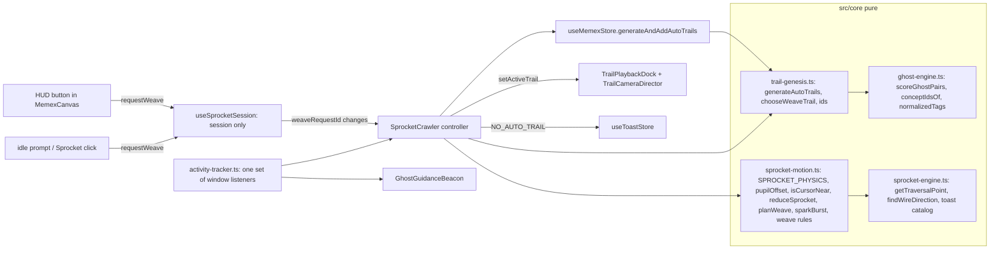
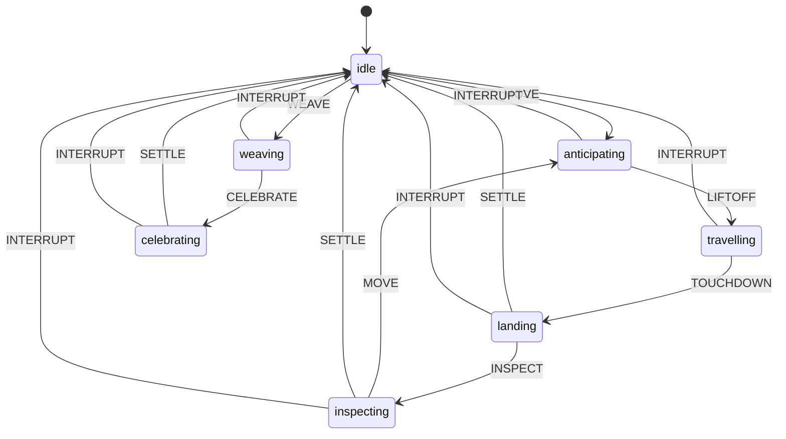

# Technical Design: Sprocket 2.0 & AI Auto-Trail Genesis
## 1. Architecture Overview

- `src/core/trail-genesis.ts`: the three trail builders, deterministic ids, duplicate test and the weave choice. Pure.
- `src/core/sprocket-motion.ts`: squash and stretch constants, eye geometry, the state machine, the weave plan (legs, arc length, filament path), sparks, trigger rules and copy. Pure.
- `src/core/ghost-engine.ts`: two helpers are now exported (`normalizedTags`, `sharedConceptIds`); behavior is unchanged. The nexus reuses `scoreGhostPairs`, `conceptIdsOf` and `CONCEPT_LEXICON`.
- `src/core/sprocket-engine.ts`: one new toast kind, `NO_AUTO_TRAIL`.
- `src/store/useMemexStore.ts`: `generateAndAddAutoTrails()`. No new persisted field.
- `src/store/useSprocketSession.ts`: session-only weaving state (a separate zustand store, like the toast store, so it can never reach `persistGraph`, `exportJson` or hydration).
- `src/components/canvas/activity-tracker.ts`: one shared, ref-counted set of passive window listeners (idle flag and deliberate-input callbacks) used by the Beacon and the crawler.
- `src/components/canvas/SprocketCrawler.tsx`: extended, not replaced.
- `src/components/canvas/MemexCanvas.tsx`: the trigger button in the HUD.
### Name mapping (the request came from an abandoned rewrite)
| Request | Real code |
|---|---|
| `Trail.name` | `Trail.title` |
| `stepCardIds` | `Trail.nodeIds` |
| `color` | derived from `origin` via `EDGE_COLORS` (no field) |
| cards | `nodes` (`MemexNode`) |
| `activeStepIndex` | `activeTrailIndex` |
| the dock | `TrailPlaybackDock`, opened by `setActiveTrail(id)` |
| trail kind | encoded in the id (`t-auto-<kind>-<hash>`), read with `autoTrailKind(id)`; no `kind` field |
**No schema change.** Nothing in `Trail` was added, because the id already carries the kind and the color derives from `origin`. Old saves, `serializeGraph`, `deserializeGraph` and the deterministic export are untouched; a test round-trips a graph with auto trails and checks that a trail has exactly the six existing keys.
## 2. Squash and Stretch
### 2.1 Where it is applied
Inside the sprite `<button>` (so the hit area and the pupil math keep a stable box), three nested wrappers, all with `transform-origin: 50% 100%`:
1. squash and stretch: `scaleX`, `scaleY` motion values;
2. happy wag: `rotate`, `x` motion values;
3. the Spec 06 body (bob, inspect tilt) and the spin.
The zoom counter-scale of Spec 06 stays on the outer wrapper, so squash is in sprite space at every zoom.
### 2.2 Constants (`SPROCKET_PHYSICS`)
| Phase | scaleX | scaleY | Timing |
|---|---|---|---|
| rest | 1 | 1 | |
| anticipation | 1.25 | 0.7 | 150 ms, ease-out |
| flight | 0.8 | 1.35 | eases in over 120 ms at lift-off, held until touchdown |
| landing | 1.2 | 0.75 | set at once, then spring to 1 with `{ stiffness: 450, damping: 18 }` |
Only the `scaleY` of the landing (0.75) was specified; the 1.2 `scaleX` keeps the volume. The landing spring is underdamped (damping 18 against stiffness 450, ratio about 0.42), so it overshoots 1.0 slightly and rests in roughly 0.4 s. The UI springs elsewhere stay at stiffness 300 and damping 28.
Sprocket does not rotate toward the direction of travel, so the stretch is vertical (the minimum the request allowed).
### 2.3 Timeline of one move
A trail-follow move, 800 ms in all so it lands as the camera glide ends:
```
t = 0 ms     MOVE            idle -> anticipating     scale -> (1.25, 0.70) over 150 ms      mode poised (no bob)
t = 150 ms   LIFTOFF         -> travelling            scale -> (0.80, 1.35) over 120 ms      mode scurrying (legs rock)
             position follows getTraversalPoint (hop 15 %, wire 70 %, hop 15 %), easeInOut over 650 ms
t = 800 ms   TOUCHDOWN       -> landing               scale set to (1.20, 0.75), spring to (1, 1)
             rebound rests (about 0.4 s)  SETTLE      -> idle, mode perched (bob resumes), snap to the perch
```
The same wind-up and flight apply to a relocation (a spring instead of the tween, as in Spec 06) and to the two legs of the ghost reaction: the flight is 650 ms after a 150 ms wind-up (800 ms in all, as before), the landing at the synapse starts the 2 s inspection (`landing -> inspecting`), and the move back starts from `inspecting`.
A new move, a weave, an invalidating store change or an unmount calls `interrupt()`: it runs every stored clear function (timers and tweens), stops the scale animations and sends INTERRUPT.
## 3. Eye Tracking and the Happy State
```
pointermove (window, passive) -> store clientX/Y in a local, schedule one rAF
rAF:  box = button.getBoundingClientRect()           // once per frame at most
      center = box center (screen px)
      offset = pupilOffset(center, pointer, 6)       // pure, total
      pupil motion values = offset * (1.5 / 6)       // into the socket
      near = isCursorNear(distance, happy ? 68 : 60) // 8 px hysteresis
      if near changed -> controller.setHappy(near)
```
- `pupilOffset`: direction toward the pointer, length `min(maxRadius, distance)`; NaN coordinates, a radius that is not a positive finite number and a pointer on the center give `{0, 0}`; infinite coordinates count as `±1e12`.
- The pupil group is a `motion.g` with `x`/`y` motion values, so the SVG transform updates without React. The open eye (two color circles, amber and violet cross-faded by `awake`) and the happy arch (a quadratic curve `M13.4 13.9 Q16 9.7 18.6 13.9`, also amber and violet) sit in two groups whose opacities are `1 - happy` and `happy` (a motion value animated over 180 ms). It is an opacity cross-fade between two shapes; no path morphing and no filter.
- Happy also starts the wag: `rotate` and `x` motion values mirror between `-6°/-0.8` and `+6°/+0.8` with a half period of 260 ms (520 ms period). Reduced motion keeps the cross-fade but not the wag.
- Sprocket's own `x`/`y` motion values schedule a refresh, so the pupil follows him while he moves and the cursor rests. A pan or zoom with a resting cursor is not tracked until the next pointer move (limitation).
- Leaving the window (`pointerleave` on the root element, `mouseout` with a null `relatedTarget`, `blur`) cancels the frame, eases the pupil to the center and ends the happy state. Touch pointers are ignored. All listeners are passive and removed in the effect cleanup.
## 4. State Machine

The `happy` flag is separate: HAPPY_ON and HAPPY_OFF change it in any state and never the state. `reduceSprocket` returns the same object for an ignored event, so the controller learns from `next === machine` whether anything happened (`dispatch()` returns a boolean).
How the controller uses it:
- Every activity starts with `interrupt()` (stop, then INTERRUPT), so MOVE is always legal at the start.
- A weave refuses to start in `weaving` or `celebrating`, and the Spec 06 relocate, traverse and react ignore requests in those two states (a card added mid-weave does not yank Sprocket away).
- During a weave the state stays `weaving`; the per-leg wind-up, stretch and landing are driven directly (the machine events of an individual leg are ignored in that state).
- The ghost "!" alert is the `idle` state with a badge (the Spec 06 `mode`); `mode` (`perched`, `poised`, `scurrying`, `alert`, `inspecting`, `celebrating`) remains the visual variant selector, the machine is the lifecycle.
## 5. Auto-Trail Genesis
### 5.1 Normalisation and determinism
Nodes are sorted by id (a repeated id keeps the first in sorted order: the only input-order dependence, impossible in a real graph). Edges between two distinct existing cards are sorted by `(source, target, id)`. Discoveries only add neighbours, so their order is irrelevant. `createdAt` defaults to the newest `createdAt` among the trail's own cards (fallback `TRAIL_EPOCH`), never the clock. `maxSteps` is clamped to `[3, 8]`.
Id: `t-auto-<kind>-<hash>` where `hash` is FNV-1a over `nodeIds.join("\0")`, as 8 lowercase hex digits. If two kinds yield the same ordered sequence, only the first (lineage, then debate, then nexus) is kept.
### 5.2 Lineage Arc (`lineage`)
1. `getChronologicalNodes(nodes)`: dated cards, sorted by event key (`year`, else `date`), then `createdAt`, then `id`.
2. Fewer than 3: no trail.
3. At most `maxSteps`: all of them.
4. More: keep the first and the last; the middle cards are ranked by (a) degree, the number of distinct neighbours through real edges and discoveries, descending; (b) the rank in `bisectionOrder(middle.length)` (middle, then the middles of each half, breadth first, so a prefix is evenly spread); (c) id. Take `maxSteps - 2` of them and restore chronological order. The result is a subsequence of the chronological list, so years never decrease.
5. Description: "A chronological arc of N dated cards from Y0 to Y1. It opens with "T0" (Y0) and closes with "T1" (Y1). Intermediate stops: ... Chosen from M dated cards: ... Recurring concepts: ..." Concepts are the lexicon labels that at least two of the trail's cards touch.
### 5.3 Dialectical Debate (`debate`)
1. Take the edges with `getEdgePolarity === "refutes"`. None: no trail. Polarity is never inferred.
2. Connected components over those edges (undirected). For each, the synthesis cards are the other endpoints of `synthesizes` edges that touch the component. Size = component plus synthesis cards; under 3 is skipped. The largest wins (ties: the component with the smallest first id).
3. Order: refuting cards first, then the synthesis cards, so the trail ends on a synthesis. Each group is ordered chronologically when all its cards are dated; otherwise by first appearance in the sorted edge list.
4. Over `maxSteps`: the synthesis group keeps `min(size, max(1, floor(maxSteps / 4)))` cards (2 at 8), the refuting group is cut from its end.
5. Description names the recorded tensions and syntheses neutrally ("A" and "B" linked by a refutes edge); it does not claim which card refutes which, because the edge direction does not define that in this codebase.
The demo seed has no `refutes` edge, so the trail is correctly omitted on the seed.
### 5.4 Dense Conceptual Nexus (`nexus`)
Affinity of a pair is `GhostPairScore.base` from `scoreGhostPairs` (0.3 · sqrt cosine of TF-IDF + 0.5 · Ochiai of concept sets + 0.2 · Jaccard of tags; the cross-era boost is left out, because it rewards distance in time, not density).
1. Seed: the pair with the highest `base`, provided it reaches `NEXUS_MIN_AFFINITY` (0.25). Ties go to the smaller ids (pairs come sorted by id). None: no trail.
2. Grow: for each outside card compute its mean affinity to the cluster. Only cards at or above 0.25 are candidates. Rank = mean + 0.05 when a real edge or discovery joins the card to any cluster member (the boost is not part of the gate). Take the best (ties: smaller id). Stop at `maxSteps` or when no candidate qualifies.
3. Fewer than 3 cards: no trail.
4. Invariant: the seed pair is at least 0.25 and each added card's mean to the earlier cards is at least 0.25, so the mean pairwise affinity of the cluster is at least 0.25 and every card has at least one partner at 0.25 or more.
5. Order: chronological when all cards are dated. Otherwise an affinity chain: start at the card with the highest total affinity within the cluster (ties: id), then always the unvisited card closest in affinity to the last (ties: id).
6. Description: the cards with years, recurring concepts and shared tags.
Why 0.25 (the ghost's suggestion threshold is 0.3): a cluster is judged on its mean, which is a gentler test than one pair, and 0.25 on the seed keeps the four mutually related cards and drops the two outliers.
### 5.5 Demo seed result
| Trail | Cards (in order) |
|---|---|
| Lineage Arc | MEM-1945-01, MEM-1965-02, MEM-1968-03, MEM-2017-04, MEM-2024-05, MEM-2024-06, MEM-2026-07 (all seven dated cards; the two 2024 cards tie on year and are ordered by `createdAt`) |
| Dense Conceptual Nexus | MEM-1945-01, MEM-2017-04, MEM-2024-05, MEM-2026-07 (memory, retrieval and knowledge concepts; pair affinities 0.22 to 0.45, mean 0.34) |
| Dialectical Debate | omitted: no `refutes` edge |
Neither equals a seed trail, so both are added.
### 5.6 Choosing the trail to weave (`chooseWeaveTrail`)
`store.generateAndAddAutoTrails()` returns what was added. If that is non-empty, the Lineage Arc is chosen when present, otherwise the first added; the session cursor moves to the position after it in the id-sorted list of auto trails. If nothing was added, the auto trails (id matches `t-auto-(lineage|debate|nexus)-<hex>`, at least two cards left) are sorted by id and the trail at `cursor mod count` is chosen, the cursor moving one step on. No auto trail: `null`, and the crawler shows the `NO_AUTO_TRAIL` toast.
### 5.7 Store action
`generateAndAddAutoTrails()` runs `generateAutoTrails` with `createdAt = new Date().toISOString()` (the only clock, in the store), skips a candidate whose id or ordered `nodeIds` exists (`isDuplicateTrail`), adds the rest with the pure `createTrail` (which also drops unknown ids) and commits once. Nothing new: returns `[]` and does not call `commit`, so nothing is written. Playback keys are not read or written (a commit only re-validates an active trail, as for any graph change).
## 6. Weaving Show
### 6.1 Plan
`planWeave(stopIds, rects, directionOf)` makes one `WeaveLeg` per consecutive pair: `WEAVE_SAMPLES + 1 = 41` points of `getTraversalPoint(from, to, i / 40, direction)` (hop, the real wire in the stored direction or the would-be curve, hop) and the cumulative arc length fraction at each point. `legPointAt(leg, k)` interpolates between the samples, so Sprocket walks exactly the drawn polyline. `arcFractionAt(leg, k)` maps leg progress to the share of the path already walked (monotone, 0 to 1), which reveals the filament in step with Sprocket despite the easing and the hops.
### 6.2 Timeline
```
request            requestWeave() gates (>= 3 cards, no active trail, not weaving) and bumps weaveRequestId
t = 0              runWeave: generateAndAddAutoTrails, chooseWeaveTrail, plan, beginWeave (isWeaving), filament mounted,
                   status "Weaving T: stop 1 of N.", Esc listener, fitView(trail cards, padding 0.25, 800 ms)
t = 0..800 ms      approach to the first stop: 150 ms wind-up + 650 ms flight (skipped if already there), landing squash
t = 800 + 120      leg 1:  150 ms wind-up | 600 ms flight, filament revealed by arcFractionAt | landing squash | 120 ms dwell
...                legs 2 .. N-1 the same; each leg announces "stop k of N"
end                CELEBRATE (weaving -> celebrating): 360° spin 600 ms + 8 brass sparks 700 ms; filament fades over 900 ms
t_end + 700 ms     SETTLE, endWeave(), setActiveTrail(id) (the Lever opens at stop 0, the camera director glides there),
                   bubble "Woven: T, N stops. The 1945 Lever is yours, Professor." (5 s), Sprocket glides to the stop-0 perch
```
A trail of seven stops takes about 0.8 s (approach) + 6 legs × 0.87 s + 0.7 s ≈ 6.8 s.
### 6.3 Filament
An absolutely positioned `<svg width=1 height=1 overflow=visible>` in the `ViewportPortal` at `z-index 1150` (under Sprocket at 1200, above the edge pills). Per leg three `motion.path` with the same `d`: amber `#FFB236` width 11 at opacity 0.16 (wide underlayer), violet `#B388FF` width 6 at opacity 0.32 (glow), violet width 2 at full opacity (core). Each takes `pathLength` from one `weaveProgress` motion value (`leg index + fraction`) through `useTransform(v => clamp(v - index, 0, 1))`, and its group opacity is 0 until its leg starts (a zero-length round cap would draw a dot). No filter, no blur. The fade is an opacity animation on the whole group, after which the React state is cleared. Under reduced motion the progress value jumps to the leg's end at each stop.
### 6.4 Camera
`fitView` once at the start over the trail's cards (800 ms). A per-leg pan was rejected: the fit already holds every stop in view, and moving the viewport under a character that is also moving makes the scene swim. The trail dock's own director then glides to stop 0 at zoom 1.15 after activation.
### 6.5 Cancel, abort, guards
- Escape (a window listener that exists only while weaving) and a click on Sprocket call `cancelWeave("cancelled")`: stop the activity, reset the scale, relocate to the perch, fade the filament over 400 ms, `endWeave()`, bubble "Weave halted. Any trail already forged stays in the Trails menu." The generated trails stay; nothing is activated. Escape and click are ignored during the 700 ms celebration (activation is imminent).
- `validate()` runs on every `nodes`, `ghostDiscoveries` or `trails` change while a weave runs. It aborts (`"aborted"`, same exit, bubble "The cards moved under my feet. Weave stopped, Professor.") when the trail is gone, a stop card is gone, or `rectsSignature` of the stops differs from the plan (a card was dragged or resized).
- A second request is dropped by `requestWeave()` while `isWeaving`; the HUD button is disabled; `controller.weave()` also refuses in `weaving`/`celebrating`. The flag is set synchronously inside the subscription, so two clicks in one tick cannot both start.
- `dispose()` (unmount): clears timers and tweens, resets the scale, removes the key listener, stops the filament fade and the wag, clears `isWeaving`.
### 6.6 Session state
`useSprocketSession` holds `isWeaving`, `weavingTrailId`, `weaveRequestId`, `weaveCursor`. It is a separate store, not part of `useMemexStore`, so none of it is persisted or exported (a test checks the export text, its key set and the store's keys).
## 7. Trigger and Idle Prompt
**Trigger path.** Button, prompt button and Sprocket click all call `useSprocketSession.requestWeave()`. The crawler subscribes to `weaveRequestId` outside React and runs the show. This needs no ref passing or imperative registry, is testable without a DOM, and the gate is pure (`canStartWeave`).
**HUD button.** In `ArchivalHud`, directly under the Wake Ghost button, above the Beacon. Rendered when `nodeCount >= 3` (primitive selector). Styled with `ghostButtonClass` (violet, as the Wake button), `flex-wrap` and `text-center` inside the HUD card (which already has `max-w: calc(100vw - 2rem)` and scrolls). Disabled with `weaveReady = canStartWeave(...)`; `aria-busy` while weaving; `aria-describedby` points to an `sr-only` hint that says why it is disabled.
**Idle prompt.** `useIdleFlag()` now reads one shared tracker: `createActivityTracker(env)` installs the five passive capture listeners (pointermove, pointerdown, keydown, wheel, touchstart) and a 1 s interval when the first subscriber arrives and removes them with the last. It flips the idle flag with `isIdle(now - last)` (strictly more than 15 000 ms), throttles bursts to 250 ms, and also forwards deliberate input (everything but `pointermove`) to `subscribeActivity` callbacks. The Beacon reads the flag through `useSyncExternalStore`; its behavior is unchanged.
When the flag turns true, the crawler checks `shouldShowWeavePrompt` (idle, not shown this period, `canStartWeave`, and `generateAutoTrails(...).length > 0`, so the offer is true). The bubble then holds the text and a real button "🧶 AUTO-WEAVE TRAIL" (`aria-label` "Auto-weave trail: let Sprocket scamper through a generated trail"). The flag turning false (any activity) only re-arms the next period; it does not hide the bubble, because moving the mouse toward Sprocket must not remove him. The bubble hides after 12 s, on deliberate input elsewhere (not Tab or Shift, not input inside `[data-sprocket-root]`), or when the weave starts. Focus inside the prompt cancels the timeout. While `promptVisibleRef` is true, `onActivate` calls `requestWeave()` instead of the quip.
## 8. Reduced Motion
| Element | Normal | Reduced |
|---|---|---|
| squash, stretch, landing | scale motion values | never set (stay 1) |
| wag | mirrored rotate and shift | none (arch cross-fade only) |
| move | wind-up, flight, landing | jump and 0.2 s fade (Spec 06) |
| weave leg | 150 + 600 + 120 ms | jump, 350 ms pause per stop |
| filament | revealed by arc length | each leg appears whole at its stop |
| camera fit | 800 ms | 0 ms |
| celebration | 600 ms spin, 8 sparks, 700 ms | 0.3 s flicker, no sparks, 300 ms |
Eye tracking stays (a pupil shift of at most 1.5 sprite units and an opacity change), the pupil is not a travelling motion.
## 9. Correctness Properties (`fast-check`, 200 runs each)
Files: `src/core/__tests__/trail-genesis.property.test.ts`, `src/core/__tests__/sprocket-motion.property.test.ts`, `src/store/__tests__/auto-trails.test.ts`, `src/components/canvas/__tests__/activity-tracker.test.ts`.
- **Property 1 (No Duplicate Cards):** for arbitrary graphs (dated and undated cards, polarity edges), no generated trail has two equal consecutive ids, or any repeated id.
- **Property 2 (Lineage Is Monotonic):** every Lineage Arc lists dated cards only with non-decreasing years, for shuffled input; with more than 8 dated cards it has exactly 8, starts at the earliest and ends at the latest.
- **Property 3 (Trails Are Valid):** every trail has 3 to `min(nodes.length, 8)` ids, all existing, origin `ghost`, id of the form `t-auto-<kind>-<8 hex>`; `maxSteps` is honored (clamped 3 to 8); fewer than 3 cards gives `[]`.
- **Determinism:** the same output for any order of nodes, edges and discoveries; no mutation; `createdAt` default is the newest card date; ids are a pure function of kind and ordered ids.
- **Debate:** omitted for every graph without a `refutes` edge; every debate card touches a refutes or synthesizes edge and one refutes edge lies inside; thesis, antithesis, synthesis example; single pair omitted; edge-order fallback; cap of 8 with the synthesis last.
- **Nexus:** mean pairwise affinity at least 0.25 and every card has a partner at 0.25; unrelated cards (with edges and discoveries between them) give `[]`; chronological when dated; an edge boost decides a tie.
- **Seed:** exactly Lineage Arc and Dense Conceptual Nexus, with the expected cards; stable under node reversal; neither duplicates a seed trail.
- **Physics:** the constants equal 0.7 / 1.25 / 150 ms, 1.35 / 0.8, 0.75 and spring 450 / 18; 150 + 650 = 800.
- **Eye:** `|pupilOffset| <= 6` and finite for any input including NaN and infinity; direction toward the pointer (cross product 0, dot product non-negative); zero at the center; `isCursorNear` equals `d <= t` on valid numbers, false on invalid ones.
- **State machine:** the table, every (state, event) pair (legal moves applied, illegal ones return the same object), INTERRUPT from any state, the orthogonal happy flag, and any 40-event sequence stays in the state set and returns to idle on INTERRUPT.
- **Weave plan:** legs start and end on the perches and stay inside the union box; `arcFractionAt` is monotone 0 to 1; legs connect; `legPointAt` matches `getTraversalPoint` at the samples.
- **Store:** idempotent second call (`[]`, same `trails` reference, no write), one write per batch, export and import round-trip, playback untouched, deleted-node trim, the session state absent from the export and from the Memex store, `requestWeave` gating.
- **Tracker:** one listener set for many subscribers, removed with the last; idle flips after the threshold and clears on activity; deliberate input is forwarded, moves are not.
## 10. Palette
`#090A0F`, `#141721` (bubble surface), `#FFB236` (amber), `#B388FF` (violet, filament core, prompt button), parchment `#F4F1EA`, brass `#D97706` / `#B45309` (chassis and sparks). No other color.
## 11. Limitations
- The choreography, filament, sparks, eye tracking, wag, prompt and HUD layout were type-checked, linted, built and tested in the pure core and the stores, but not driven in a real browser in this environment. Sizes, offsets, the feel of the springs and the wag need a manual pass. The component-level behavior (timers, motion values, pointer listeners) has no automated test.
- A pan or zoom while the cursor rests does not refresh the pupil direction until the next pointer move.
- The pupil moves at most 1.5 sprite units; the requested 6 px radius applies to the pure function and is scaled into the socket.
- The weave does not run while a trail is active (the dock and the camera director own the camera). The button says so in its title.
- Per-leg camera pans were not implemented (see 6.4).
- The stretch is vertical; Sprocket does not rotate toward the direction of travel.
- Nexus affinity depends on the whole card set (TF-IDF document frequencies), so adding an unrelated card can change which pairs clear 0.25.
- Scoring is O(n²) in the number of cards; the idle prompt computes it once per idle period and a weave once per request.
- A trail that lost cards to deletions is no longer identical to a fresh generation, so the next request can add a new one next to the shortened one.
- The weave abort treats any move or resize of a stop card as a reason to stop, even a one-pixel drag.
