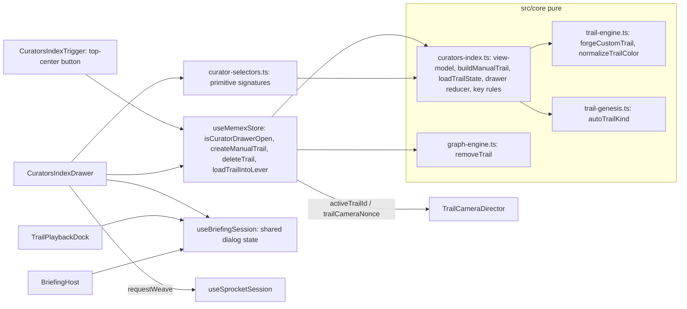

# Technical Design: The Curator's Index

## 1. Architecture Overview



- `src/core/curators-index.ts` (new, pure): `buildTrailCardModel(s)`, `buildManualTrail`, `loadTrailState`, `dedupeKeepOrder`, `sanitizeCardIds`, `uniqueTrailId`, `orderSelectedCardIds`, `blazeFormState`, `weaveQuickAction`, the drawer reducer and the key and precedence rules.
- `src/core/trail-engine.ts`: `forgeCustomTrail` accepts `meta.color`; new `normalizeTrailColor`.
- `src/core/graph-engine.ts`: new pure `removeTrail`.
- `src/core/types.ts`: `Trail.color?: string`.
- `src/store/useMemexStore.ts`: session state and three actions (section 3).
- `src/store/curator-selectors.ts` (new): primitive selectors.
- `src/store/useBriefingSession.ts` (new): shared briefing dialog state, separate from `useMemexStore`, like the toast and Sprocket session stores.
- `src/components/trails/CuratorsIndexDrawer.tsx`, `CuratorsIndexTrigger.tsx`, `key-context.ts` (new); `src/components/canvas/BriefingHost.tsx` (new).
- Changed: `TrailPlaybackDock.tsx` (shared briefing, key rules), `TrailCameraDirector.tsx` (camera nonce), `MemexCanvas.tsx` (mounts), `sprocket-engine.ts` and `sprocket-motion.ts` (copy).
- Removed: `TrailSelectorMenu.tsx`.

## 2. Name mapping and archetypes

See the table in the requirements. The archetype comes from `trailArchetype(trail)`: `autoTrailKind(id)` first (`lineage`, `debate`, `nexus`), then `origin === "ghost"` gives `ghost` ("Ghost Trail"), else `manual`. `buildManualTrail` never produces an id that matches the auto pattern, so a manual trail cannot be mistaken for a generated one.

| archetype | label | accent (no `color`) |
|---|---|---|
| lineage | AI Lineage Arc | violet `#B388FF` (origin `ghost`) |
| debate | Dialectical Debate | violet |
| nexus | Conceptual Nexus | violet |
| ghost | Ghost Trail | violet |
| manual | Manual Trail | amber `#FFB236` |

## 3. Store schema

```ts
// useMemexStore additions. Nothing here is persisted, exported or hydrated.
isCuratorDrawerOpen: boolean;        // default false
trailCameraNonce: number;            // default 0, bumped by loadTrailIntoLever
toggleCuratorDrawer(): void;
setCuratorDrawerOpen(open: boolean): void;
createManualTrail(name, description, cardIds, color?): string | null; // returns the new id
deleteTrail(trailId): void;
loadTrailIntoLever(trailId): void;
```

- `createManualTrail` returns `string | null`. Call sites written for a `void` action still work; `forgeTrail` already returned the same type, and now delegates to it.
- `isCuratorDrawerOpen` stays as it is across `hydrate`, `resetToSeed` and `importJson` (interface state like `isTimelineOpen`); it starts `false`. `exportJson` and `persistGraph` serialize `pick(state)`, which holds only `nodes`, `edges`, `trails` and `ghostDiscoveries`, so the flag cannot leak (a test checks it).
- **Trail data model.** `Trail` gains only `color?: string`. `forgeCustomTrail` keeps it only when it matches `#RRGGBB` (stored upper-case); otherwise the key is absent. Readers call `normalizeTrailColor`, so a hand-edited save with a bad color falls back to the origin color. Auto trails and the seed never set it, so they keep exactly six keys. Old saves have no `color` and load unchanged. Key order in the JSON stays deterministic because `color` is appended after `createdAt`.
- **`deleteTrail`** uses `removeTrail` (pure): the trail leaves `trails`; discoveries converted into it lose `trailId`; nodes, edges and other trails keep their identity. It goes through `commit`, which already resets playback when the active trail vanishes and writes once. Edge `data.trailId` (a seed annotation nothing reads) is left alone so the canvas does not re-render for it.
- **Weaving state.** `useSprocketSession.weavingTrailId` is not written by `deleteTrail` (that would create a cycle between the two stores: the session store imports `useMemexStore`). Instead the drawer disables Load and Delete for the trail being woven, and `SprocketCrawler` already aborts gracefully when a trail disappears (Spec 07, 5.10).
- **`loadTrailIntoLever`** applies `loadTrailState(trails, id)` (`null` for unknown or empty trails: no change at all), closes the drawer and bumps `trailCameraNonce`.

### How the camera reaches stop 1
`TrailCameraDirector` runs `setCenter(x + w/2, y + h/2, { zoom: 1.15, duration: 800 })` in an effect on `[activeTrailId, activeTrailIndex]`. Loading a trail from nothing, from another trail, or from another stop changes one of them, so the camera already glides. The one case where neither changes is re-loading the trail that is playing at stop 1 after the user panned away. `loadTrailIntoLever` therefore bumps `trailCameraNonce`, and the effect depends on it too. No other change to the director.

## 4. Spring and motion specs

| What | Spec |
|---|---|
| Drawer slide | `initial { x: "-100%" }`, `animate { x: 0 }`, `exit { x: "-100%" }`, spring `{ stiffness: 300, damping: 28 }` |
| Reduced motion | `initial { opacity: 0 }`, `animate { opacity: 1 }`, `exit { opacity: 0 }`, `{ duration: 0.15, ease: "linear" }`; no `x` |
| Hover and press | `color`, `border-color`, `transform` (2 px press) at 100 ms, as the other HUD buttons |

No `width`, `height`, `top` or `left` animation. No SVG filter, `backdrop-blur` or blur filter. The static `box-shadow` glows follow the HUD buttons.

## 5. Layout and wireframe

```
┌──────────────────────────────── drawer: absolute top-4 bottom-4 left-4, w 420 (max 90vw), z-40 ┐
│ ● 5 trails on file                                         [✕ CLOSE / ESC]                │
│ THE CURATOR'S INDEX // REEL ARCHIVE                                                       │
│ [🧶 AUTO-WEAVE NEW TRAIL]   (disabled hint under it when it cannot run)                  │
│ ┌ trail card ──────────────────────────────────────────────────────────────────────────┐ │
│ │ ▬ Lineage Arc                                                                        │ │
│ │ (AI Lineage Arc) (On the lever) (New)                                                │ │
│ │ description, up to 3 lines                                                           │ │
│ │ 5 stops • 1945 → 2026                                                                │ │
│ │ (As We May Think) → (Hypertext…) → (Attention… · Vaswani et al.) → … → (+2)          │ │
│ │ [▶ LOAD INTO 1945 LEVER] [⚡ BRIEFING]                                   [🗑]  / Delete? ✓ ✕ │ │
│ └──────────────────────────────────────────────────────────────────────────────────────┘ │
│   … scrolls …                                                                             │
│ ──────────────────────────────────────────────────────────────────────────────────────── │
│ [+ BLAZE NEW TRAIL]  →  name · description · Selected on canvas: 3 (ordered list) · hint │
└───────────────────────────────────────────────────────────────────────────────────────────┘
```

- Chassis `#090A0F`; cards, form `#141721`; border `rgba(255, 178, 54, 0.2)`; text tokens `text-primary` and `text-muted`.
- The drawer is mounted in `MemexCanvas` next to the Synapse Inspector, outside `<ReactFlow>`, in the full-screen relative container. React Flow's own stacking context keeps its z-indexes (Sprocket 1200) inside it, so the drawer at z-40 is above all of them.
- **Top-left HUD (260 px card).** The drawer starts at the same left margin, so it overlays the HUD while open. That is intended: the HUD returns when the drawer closes. The Controls (bottom left) are covered the same way. The bottom timeline is centered and partly covered on narrow screens; the playback dock is not (it is hidden or centered).
- **Trigger.** A `Panel position="top-center"` where the dropdown was, about 230 px wide, so it clears the 276 px HUD at widths above about 800 px.
- **Synapse Inspector (right, 360 px).** Both may be open at 1100 px and wider. Below that, opening either one closes the other (`useInspectorExclusion`, `matchMedia("(max-width: 1099px)")`). The toaster is at the right and never meets the drawer.
- **Modals** (z 2000) and the toaster (z 2100) are above the drawer.

## 6. View-model

```ts
interface TrailCardModel {
  id: string; title: string; description: string; origin: LinkOrigin;
  archetype: "lineage" | "debate" | "nexus" | "manual" | "ghost";
  archetypeLabel: string;
  accent: string;            // #RRGGBB: valid Trail.color, else EDGE_COLORS[origin]
  hasCustomColor: boolean;
  stopCount: number;         // stops whose card exists
  eraSpan: { from: number; to: number } | null;   // min and max getEventYear
  eraLabel: string | null;   // "1945 → 2026" | "1945" | null
  summaryLine: string;       // "5 stops • 1945 → 2026" | "1 stop" ...
  breadcrumbs: { nodeId: string; label: string; fullLabel: string }[]; // trail order, <= 6
  overflowCount: number;     // stopCount - breadcrumbs.length
}
```

- `label` = title cut to 26 code points with `…`, plus ` · Surname` / ` · Surname et al.` from `authors` when readable (`Vaswani, Ashish` and `Ashish Vaswani` both give `Vaswani`; `Jr.`, `III` and similar are skipped). Nothing is invented: the surname is always a piece of the author string, and without authors the label is the title.
- `buildTrailCardModels(trails, nodes)` returns models newest first (reverse of `trails`) and builds the card lookup once.
- **Signature selector.** `selectTrailListSignature(state)` returns `JSON.stringify(models)` while the drawer is open and `""` while it is closed. Zustand compares with `Object.is`, so a card drag (new `nodes` array, same strings) does not re-render the drawer, and a closed drawer costs one boolean read per update. `useHeld` keeps the last real list during the slide-out so the list does not blank while it leaves. `selectSelectionSignature` does the same for the blaze form's selected cards.

## 7. Drawer state machine and keyboard

State is a plain boolean (`CuratorDrawerState`). Events:

| event | effect |
|---|---|
| `toggle` | `!open` |
| `open` / `close` | `true` / `false` |
| `escape` (with a `CuratorKeyEvent`) | `false` if `isCuratorEscape(e, open)`, else unchanged |
| `hotkey` (with a `CuratorKeyEvent`) | `!open` if `isCuratorHotkey(e)`, else unchanged |
| `key` | `escape` for `Escape`, else `hotkey` (every other key leaves the state alone) |

`CuratorKeyEvent` is a plain object: `key`, `ctrlKey`, `metaKey`, `altKey`, `shiftKey`, `repeat`, `defaultPrevented`, `targetIsEditable`, `targetInsideDrawer`, `modalOpen`. The component fills the last three from the DOM (`key-context.ts`: input, textarea, select or contenteditable; `panelRef.contains(target)`; `document.querySelector('[aria-modal="true"]')`).

- `isCuratorHotkey`: key `t` or `T`, no Ctrl, Meta or Alt, not `repeat`, not `defaultPrevented`, target not editable, no modal open.
- `isCuratorEscape`: key `Escape`, drawer open, no modal open, and either the target is not editable or it is inside the drawer.

### Interaction with Esc and the other hotkeys

| Situation | Who acts |
|---|---|
| Modal dialog open | the modal (its own handler stops the event); the drawer ignores Escape and `T` |
| Drawer open, Escape | the drawer closes; the event is stopped, so the dock does not exit playback, the Synapse Inspector stays and a weave is not cancelled |
| Drawer closed, trail playing, Escape | the dock exits playback (as before) |
| Drawer open, arrows | the dock ignores them (`shouldDockHandleKeys`) |
| Typing in the blaze form | `T` and the arrows are ignored; Escape closes the drawer |
| Typing in a card editor outside the drawer | `T` ignored; Escape belongs to the editor |
| `I` (platen) | unchanged; it works with the drawer open and ignores inputs |

`resolveEscapeOwner({ modalOpen, drawerOpen, trailActive })` returns `"modal"`, `"curator-drawer"`, `"dock"` or `"none"`, in that precedence, and is tested against the reducer and `shouldDockHandleKeys`.

Mechanism: one `keydown` listener on `window` in the capture phase (`useCuratorKeyboard`). It runs before every bubble-phase window listener. When the reducer changes the state it calls `preventDefault()`, and for Escape also `stopPropagation()`, so the dock's, the Synapse Inspector's and the weave's Escape listeners never see that key press. The dock also checks `isCuratorDrawerOpen` itself, which covers keys the capture handler lets through (an arrow with the drawer open). Backspace and Delete on a button inside the drawer are stopped by the drawer's React `onKeyDown`, so React Flow (which listens on the document) cannot delete the selected cards.

## 8. Shared briefing dialog

`useBriefingSession` holds `briefing: { trailId, markdown } | null` with `openBriefing(trailId)` (builds the markdown through `generateTrailBriefing` for any known, non-empty trail) and `closeBriefing()`. `BriefingHost` renders `ExportBriefingModal` once. The dock calls `openBriefing(activeTrailId)`; the drawer calls it for the card's trail. The dock reads `briefing !== null` to mute its keys, as it did with its local state. The modal itself is unchanged and restores focus to the button that opened it.

## 9. Focus

- Open: the effect focuses the dialog element (`tabIndex={-1}`).
- Close: the effect focuses `#curators-index-trigger`. The one exception is a narrow-screen takeover by the Synapse Inspector, which keeps its own focus.
- Delete confirm: focus moves to "✕"; cancel returns it to "[🗑]"; confirm parks it on the list.

## 10. Correctness Properties (fast-check, 200 runs each)

File: `src/core/__tests__/curators-index.property.test.ts` (pure), `src/store/__tests__/curators-index.test.ts` (store).

- **Property 1 (Load).** For any trails and any id, `loadTrailState` returns `{ activeTrailId, activeTrailIndex: 0, isPlayingAuto: false }` with a matching existing trail for every known non-empty trail, and `null` for every unknown id or empty trail. The store action `loadTrailIntoLever` sets the same state, and never activates an unknown id.
- **Property 2 (Create).** For any names and repeated calls (with colliding seeds), the ids are unique and never auto-shaped; the result's `nodeIds` equal the input with repeats and unknown ids dropped, in the exact input order; fewer than 2 valid cards gives `null`. The store action returns unique ids over arbitrary names and deletes, keeps the order and persists once.
- **Property 3 (Drawer).** For arbitrary sequences of toggle, open, close, escape, hotkey and key events (keys `t`, `T`, `Escape` and others, with arbitrary modifier, repeat, typing-target, drawer-target and modal flags), the state always equals an independent reference model; `T` toggles only when allowed; every other key changes nothing; Escape never opens and changes the state only when the drawer is open.
- Unit tests: `buildTrailCardModel` (era span, single year, no era, stop count with missing cards, breadcrumb order, overflow, truncation, authors, invariants, round trip through the signature), archetype mapping including the Ghost Trail fallback for seed and discovery trails, Escape precedence and the dock's key gate, selection order, blaze form, weave action, `removeTrail`, color round trip and old saves, auto trails keeping six keys, `deleteTrail` (active exit, persist once, unknown no-op, regeneration), session-only state not in the export, selector stability during a drag, the shared briefing state.

## 11. Limits and trade-offs

- The canvas keeps no click order, so a blazed trail follows position (left to right, then top to bottom). The form says so. A different order needs a later reorder control.
- No color picker: `createManualTrail` accepts a color, but the form does not offer one (the palette is fixed). Only code or a hand-edited save sets it.
- The drawer overlays the HUD and the Controls while open.
- Visual and interaction behavior (slide, focus return, hotkeys in a real browser, stopPropagation ordering) is covered by pure rules and store tests, not by a browser test: the project has no DOM test environment.
