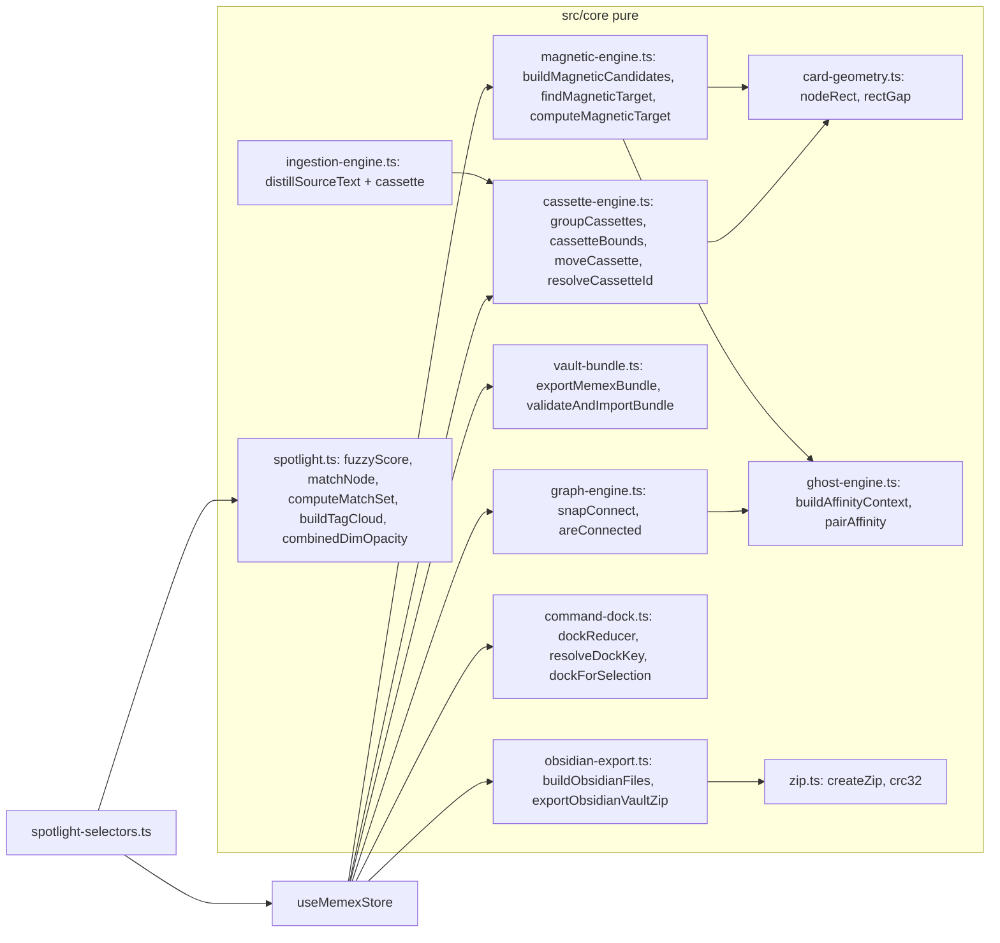
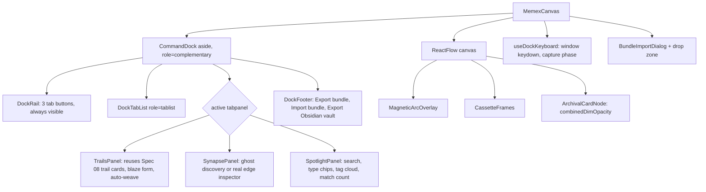

# Technical Design: The Research Command Console & Tactile Spatial Engine

## 1. Architecture Overview



New files: `src/core/{card-geometry,magnetic-engine,cassette-engine,vault-bundle,obsidian-export,zip,spotlight,command-dock}.ts`, `src/store/spotlight-selectors.ts`, tests `src/core/__tests__/vault-and-magnetic.property.test.ts` and `src/store/__tests__/command-console.test.ts`.

Changed: `types.ts` (`cassetteId?`, `cassetteTitle?`), `ghost-engine.ts` (shared pair scoring, `buildAffinityContext`, `pairAffinity`), `graph-engine.ts` (`areConnected`, `snapConnect`), `ingestion-engine.ts` (cassette), `trail-engine.ts` (`isValidEventDate`), `useMemexStore.ts`, `IngestionPlatenModal.tsx` (passes the arXiv cassette id and the existing cassettes).

## 2. Name mapping and deviations from the request

| # | Request said | Built | Why |
|---|---|---|---|
| a | Euclidean distance < 260 px | the gap between the two card rectangles, below 260 | Cards are 340 x 230. A center distance below 260 means the cards overlap heavily, so nothing could snap before touching. |
| b | affinity >= 0.70 | calibrated confidence (the X% on pills) >= 0.70 | Raw ghost scores top out near 0.65, so 0.70 never applies to them. Calibrated confidence is 0 below the detection threshold and 0.78 to 0.96 above it, so every discoverable pair qualifies and nothing below the threshold snaps. |
| c | `findMagneticTarget(draggedRect/center, ...)` | `findMagneticTarget(draggedRect, candidates, nodes, range)` | The rectangle form is needed for the gap. A center is just a zero-size rect. |
| d | `Partial<MemexStore>` from the importer | `BundleImportResult` | Core cannot import the store. The store applies the result. |
| e | dangling edges rejected or dropped | rejected | See section 7. |
| f | `ZIP` in `vault-bundle.ts` | `obsidian-export.ts` re-exported from `vault-bundle.ts`, writer in `zip.ts` | Keeps each file focused. Import paths from `vault-bundle` work as requested. |
| g | cassette "unless the same source" | same id and same title reuse the cassette | Same text always hashes to the same id, so re-ingesting a source joins its cassette. A different title on the same id (a hash collision, or a hand-built id) gets `-2`, `-3`. |
| h | spec 08 drawer reducer | kept for the old tests; the dock reducer replaces its role | Phase B deleted the drawer component; `curatorDrawerReducer` and its tests stay in the core. |
| i | `CommandDock`, 44 px rail, 420 px panel, `DockFooter` (phase B) | `ResearchCommandDock` in `components/canvas/`, 48 px rail, 400 px panel, no footer | Names and sizes follow the Phase B request. The vault actions moved to a top-bar `[💾 VAULT]` menu, because a footer in a right dock is out of reach while it is collapsed. |
| j | `CassetteFrames`, a div per cassette "in the viewport layer" | `MicroficheCassetteOverlay`, plate at `z-index: -1` and label tab at `z-index: 5` in one `ViewportPortal` | See section 5. |
| k | Escape only collapses the dock | collapsing from the Synapse tab also clears the selection | The old inspector's Escape closed it and cleared the selection; the pill would otherwise stay highlighted with no panel. |
| l | Toasts have fixed catalog text | `pushToast(state, kind, message?)` and the kinds `SNAP`, `VAULT`, `VAULT_ERROR` | A snap and a restore name their cards or counts. |

Superseded behavior (documented in specs 03 and 08): the Curator's Index left drawer becomes the Trails tab of the right dock; the Synapse Inspector drawer becomes the Synapse tab; the narrow-screen exclusion between them is moot.

## 3. Proximity math (magnetic range)

```
rect(card)  = { x, y, w, h }   w,h from style.width/height, else node.width/height,
                                else measured, else 340 x 230
dx = max(a.x - (b.x + b.w), b.x - (a.x + a.w), 0)
dy = max(a.y - (b.y + b.h), b.y - (a.y + a.h), 0)
gap(a, b) = hypot(dx, dy)         0 when the rectangles overlap or touch
snap range: gap < MAGNETIC_RANGE_PX (260), strictly
```

```
 dragged                       target
┌────────┐                    ┌────────┐
│        │◄──── dx = 160 ────►│        │      gap = 160 (< 260: in range)
└────────┘                    └────────┘      centers are 500 apart (> 260)
```

The gap is symmetric, never negative, and 0 for overlapping cards.

### Two phases
1. **Drag start** (`beginMagneticDrag`): `buildMagneticCandidates(draggedId, nodes, edges)`.
   - Build one `AffinityContext` for the whole canvas (TF-IDF vectors, tag sets, concept sets, years; O(canvas)).
   - For every other card that is not connected to the dragged one (real edges, either direction), `pairAffinity` gives `{ score, affinity, sharedConcepts }`. Keep affinity >= 0.70.
   - For each kept pair compute the concept label (first shared lexicon concept, else a shared tag, else a shared keyword, else "related ideas") and `synthesizeBridgeRationale`.
   - Sort by affinity descending then id. The store caches the list, plus a `Map` of the candidate cards, in a module-level variable.
2. **Per frame** (`updateMagneticDrag`): read the dragged card (O(1) through an index hint, falling back to a search only if the order changed), compute its rect, call `findMagneticTarget`, which loops over the candidates and computes one `rectGap` each. Nearest wins; ties go to the higher affinity, then the smaller id. The store writes `magneticTarget` only when `sameMagneticTarget` says it changed.

**Why per-frame cost is O(candidates):** no text, vectors or sorting run per frame; the other cards do not move while one card is dragged, so their rectangles are cached at drag start. A canvas of 300 unrelated cards and 3 related ones costs 3 gap checks per frame (a test drives 2000 frames).

`pairAffinity` returns exactly what the scan computes: both go through the same `prepareCorpusFeatures` and `scorePreparedPair`, and a test compares them for random corpora. `detectGhostSynapses` is unchanged.

### Snap
`snapConnect(state, sourceId, targetId, { rationale, strength })` in `graph-engine.ts` connects like `acceptDiscovery` (origin `human`, id `e-human-<source>-<target>`), consumes any discovery for the pair (either orientation) and returns the same state for a self-pair, a missing card, or a pair already connected in either direction. The store commits it once and sets `lastSnapEdgeId` for 1200 ms.

## 4. Magnetic arc rendering (phase B)

All SVG, no filters, `transform` and `opacity` only.

- **Where:** one overlay component inside `<ReactFlow>` using `ViewportPortal`, mounted once. Z-order: the arc layer has `z-index: 900` (above idle cards and edges at 0, below the dragged card, which React Flow elevates to 1000 on select) and the whisper pill `1100`; both set `pointer-events: none`, so a drag is never blocked. It subscribes to `magneticTarget` (changes only when the offer changes) and reads the two card rectangles for positions.
- **Path:** a quadratic Bezier from the closest point on the dragged rectangle to the closest point on the target rectangle. Closest points: clamp the other rectangle's center into this rectangle (and the reverse). Control point = midpoint pushed 20% of the length along the normal, so the arc always bows the same way.
  ```
  M p0 Q c p1      c = mid + n * 0.2 * |p1 - p0|
  ```
- **Layers:** a wide translucent stroke (`#B388FF` at 0.25, width 6) under a crisp 1px stroke (`#B388FF`), plus registration `+` marks at both ends, as the ghost edges do.
- **Motion:** the crisp stroke has `stroke-dasharray: 6 8` and a CSS animation of `stroke-dashoffset` (a "marching" pulse). The jitter is a `transform: translate(Xpx, Ypx)` keyframe animation of +-1px on the `<g>` wrapper (steps, 90 ms). Neither touches layout or paint-heavy properties.
- **Label:** a small pill at the midpoint, "⚡ 87% · associative linking", in `font-mono`, the same pill style as the synapse pills.
- **Target card:** a static violet `box-shadow` ring while targeted (set through a class, not animated).
- **Snap:** the new edge (`lastSnapEdgeId`) plays one amber `#FFB236` pulse (opacity 0 to 1 to 0.4 over 1.2 s). The arc fades out.
- **Reduced motion:** no dash animation, no jitter, no pulse keyframes: the arc is static and the snap is an opacity step.

## 5. Cassette bounding-box math

```
valid(r)   = x, y, w, h finite, |each| <= 1e9, w >= 0, h >= 0
minX = min(r.x)        maxX = max(r.x + r.w)        (over valid rects)
minY = min(r.y)        maxY = max(r.y + r.h)
frame = { x: minX - p, y: minY - p, width: (maxX - minX) + 2p, height: (maxY - minY) + 2p }
p = padding (default 24); a negative or non-finite padding counts as 0
```

- Every corner of every valid rectangle lies at least `p` inside the frame (strictly inside for `p > 0`). The 1e9 bound keeps float spacing far below 24 px, so strictness is exact. With `p = 0` the frame touches the extreme rectangles (equal up to rounding).
- No valid rectangle gives `null`.
- `moveCassette` adds `(dx, dy)` to every member position and keeps non-members by reference. The frame moves with its members, which a test checks.

### Frame component (phase B)
- **Z-order (verified in `@xyflow/react` 13.0.3 and `@xyflow/system` 1.0.1):** `ViewportPortal` renders into `.react-flow__viewport-portal`, the LAST child of `.react-flow__viewport` (after the edges, the connection line, the edge-label layer and the nodes). The portal element has no `z-index`, so it creates no stacking context; the viewport does (it carries the pan/zoom `transform`). Cards are positioned with `z-index: 0` (`1000` when selected, `elevateNodesOnSelect`). A portal child therefore paints ABOVE idle cards by default; a child with `z-index: -1` paints below every card and edge but above the `Background`. The plate uses `-1` and `pointer-events: none`; the label tab uses `5` (above idle cards, below selected ones) with `pointer-events: auto` and the `nopan nodrag nowheel` classes, and sits above the frame's top edge so it rarely meets a card.
- Rendered in React Flow's viewport layer, below the cards, one absolutely positioned `<div>` per cassette at flow coordinates (dashed `rgba(255,178,54,0.45)` border, `#141721` at 0.35). Frames come from `groupCassettes(nodes)` and `cassetteFrame(nodes, id)` in a `useMemo`; the count is small, and card drags change the frame as they should.
- The label tab "CASSETTE // title" is the drag handle: on `pointerdown` capture the pointer; on `pointermove` call `moveCassette(id, ddx / zoom, ddy / zoom)` with the delta since the last event; on `pointerup` call `moveCassette(id, 0, 0, { commit: true })`.

## 6. Command dock

### Component hierarchy (phase B builds it)



The dock sits outside `<ReactFlow>` (z-index 40, below modals 2000 and the toaster 2100). The rail is 48 px wide and always visible; the expanded panel is 400 px (capped at 90vw). `MemexCanvas` publishes `--memex-dock-inset` (rail, or rail plus panel on viewports of 900 px and wider); the minimap and the toaster shift left by it (class `memex-dock-shift`), and the timeline and the playback dock shift by half of it and narrow their maximum width (class `memex-dock-shift-half`), all with `transform` only. Below 900 px the open panel overlays the canvas. It slides in with `x: 100%` to `0` on the spring `{ stiffness: 300, damping: 28 }`, or fades in 150 ms under `prefers-reduced-motion`.

### State machine

State: `{ open: boolean; tab: "trails" | "synapse" | "spotlight" }`. Initial `{ open: false, tab: "trails" }`. Every transition returns the same object when nothing changes.

| event | effect |
|---|---|
| `openTab(tab)` | `{ open: true, tab }` |
| `toggleTab(tab)` | open on `tab` collapses (tab kept); otherwise `{ open: true, tab }` |
| `collapse` | `open: false`, tab kept |
| `expand` | `open: true`, tab kept |
| key `T`/`t` (allowed) | `toggleTab("trails")`; `preventDefault` |
| key `/` (allowed) | `openTab("spotlight")`; focus request; `preventDefault` |
| key `Escape` (allowed) | `collapse`; `preventDefault`, `stopPropagation` |
| any other key | unchanged, nothing prevented |
| selection set (`dockForSelection`) | `openTab("synapse")`; clearing changes nothing |

"Allowed" for `T` and `/`: no Ctrl/Meta/Alt, no `repeat`, not `defaultPrevented`, target not editable, no modal open. For `Escape`: dock open, no modal, and the target is not editable or is inside the dock.

| Situation | Who acts |
|---|---|
| modal open | the modal; the dock ignores `T`, `/` and Escape |
| dock open, Escape | the dock collapses; the event is stopped, so playback does not exit and a weave is not cancelled |
| dock closed, trail playing, Escape | trail playback exits (as before) |
| dock open, arrows | trail playback ignores them (`shouldPlaybackHandleKeys`) |
| typing in the Spotlight field, `/` or `T` | typed normally |
| typing in the Spotlight field, Escape | the dock collapses |
| typing in an inline card editor, Escape | the editor |

`resolveDockEscapeOwner({ modalOpen, dockOpen, trailActive })` returns `"modal"`, `"command-dock"`, `"playback"` or `"none"` in that precedence.

Mechanism (phase B): one `keydown` listener on `window`, capture phase (`useDockKeyboard`), builds a `DockKeyEvent` from the DOM (`key-context.ts`: `isEditableTarget`, `isModalDialogOpen`, `dockRef.contains(target)`), calls `store.dispatchDockKey(event)` and applies the result (`preventDefault`, `stopPropagation`). The Spotlight field focuses itself when `dockFocusRequest` changes.

### Store contract

```ts
commandDock: { open: boolean; tab: DockTab }      // session-only
dockFocusRequest: number                          // session-only; +1 per "/"
inspectedEdgeId: string | null                    // session-only
isCuratorDrawerOpen: boolean                      // alias: open && tab === "trails"
openDockTab(tab); toggleDockTab(tab); collapseDock(); expandDock();
dispatchDockKey(event): DockKeyResult
inspectEdge(id | null); selectGhostDiscovery(id | null)
```
`isCuratorDrawerOpen` is written together with `commandDock` in one `set()`. `toggleCuratorDrawer` and `setCuratorDrawerOpen` decide from the alias flag, so a test that sets the flag by hand stays consistent.

## 7. Serialization schema and validation rules

### Bundle (`schema: "memex-bundle"`, `version: "2.0"`)

```jsonc
{
  "schema": "memex-bundle",
  "version": "2.0",
  "exportedAt": "2026-01-02T03:04:05.000Z",
  "cards": [                       // MemexNode[], runtime fields stripped
    { "id": "...", "type": "memexCard", "position": { "x": 0, "y": 0 },
      "style": { "width": 340, "height": 230 },
      "data": { "archivalId": "...", "title": "...", "content": "...", "cardType": "note",
                "tags": [], "createdAt": "...",
                "imageUrl?": "", "confidence?": 0.9, "date?": "1945-07", "year?": 1945,
                "source?": "", "pdfUrl?": "", "authors?": [], "cassetteId?": "", "cassetteTitle?": "" } }
  ],
  "edges": [ { "id": "", "source": "", "target": "", "type": "associative",
               "style?": { "stroke": "#FFB236" },
               "data": { "origin": "human", "rationale": "", "strength": 0.5,
                         "trailId?": "", "polarity?": "supports", "discoveryId?": "" } } ],
  "trails": [ { "id": "", "title": "", "description": "", "origin": "human",
                "nodeIds": [], "createdAt": "", "color?": "#FFB236" } ],
  "ghostDiscoveries": [ { "id": "", "sourceId": "", "targetId": "", "rationale": "",
                          "confidence": 0.9, "trailId?": "", "discoveredAt": "" } ],
  "ghostSettings": { "engine?": "neural", "threshold?": 0.3, "dismissedDiscoveryIds": [] }
}
```

`edges[].style.stroke` is kept because the demo seed writes it; only a hex color is accepted. Key order is fixed by the exporter. Optional keys are written only when present.

### Legacy format (`1.x`)
The `serializeGraph` output: `{ nodes, edges, trails?, ghostDiscoveries? }` with no `schema`. It is read with the same per-item rules, returns `version: "1.x"` and a warning, and has no ghost settings.

### Validation pipeline
1. String over 5,000,000 characters, or over 5,000,000 UTF-8 bytes: reject.
2. `JSON.parse` in a try block; the root must be a plain object.
3. Walk the whole parsed tree (iteratively): reject `__proto__`, `constructor`, `prototype` as keys, and nesting deeper than 32.
4. Header: bundle needs `schema === "memex-bundle"` and a `2.x` version; otherwise the legacy shape (`nodes` and `edges` arrays); otherwise reject.
5. List sizes against the limits (2000 / 10000 / 500 / 1000), then each item through a field-by-field reader that builds a fresh object. A reader never spreads or copies an untrusted object. Unknown keys are counted, not copied.
6. Uniqueness of card, edge, trail and discovery ids.
7. Reference checks: every edge endpoint, trail stop and discovery endpoint exists.
8. Any error: `{ ok: false, errors }` (at most 25 listed). Else `{ ok: true, version, state, ghostSettings, warnings }`.
9. The whole function is wrapped in a try/catch that returns a generic error, so it cannot throw.

### Limits

| What | Limit |
|---|---|
| bundle size | 5,000,000 bytes |
| cards / edges / trails / discoveries / dismissed ids | 2000 / 10000 / 500 / 1000 / 10000 |
| title / content / rationale / tag / short field / id | 2000 / 200,000 / 10,000 / 200 / 500 / 200 characters |
| tags per card / authors / trail stops | 100 / 200 / 2000 |
| position / card side | +-1e7 / (0, 1e5] |
| year | integer 0 to 9999 |

### Dangling references: rejected
Edges, trail stops and discoveries that name a missing card fail the import. Reasons: the app never writes them (the "no dangling edges" invariant of Spec 01), so one means damage or hand editing; dropping them would silently lose links; the error names the offender so the user can fix the file. The cost is that one bad link blocks the import, which a user can resolve by editing the file.

### Restore flow (phase B)
File chosen or dropped, read as text (reject over 5 MB before reading), `validateAndImportBundle`. On errors: an alert list, nothing changes. On success: a confirmation dialog with the counts (from `state`) and the warnings; only "Replace workspace" calls `store.importBundle(text)` (it validates again, so there is no gap between check and apply). The legacy `.json` export is accepted too, with its warning shown.

## 8. Obsidian export and the ZIP format

Each card becomes `Memex Vault/<Name>.md`:

```
---
title: "Alpha"
archivalId: "MEM-1945-01"
type: note
year: 1945
tags:
  - "memex"
source: "arXiv:1706.03762"
authors:
  - "Ashish Vaswani"
pdfUrl: "https://arxiv.org/pdf/1706.03762"
cassette: "cassette-1706.03762"
cassetteTitle: "Attention"
createdAt: "1945-07-01T00:00:00.000Z"
---

<card content verbatim>

## Associative Links

- → [[Beta]] · refutes · why
- ← [[Gamma]] · supports · because
```

Names: see Requirement 5.6 and 5.7. The name map is computed from cards sorted by id, so a collision gives the same names whatever the input order.

### ZIP layout (`zip.ts`)

```
[local header 30 B + name + data] x N
[central directory header 46 B + name] x N
[end of central directory 22 B]
```

- Local header: signature `0x04034b50`, version 20, flags `0x0800` (UTF-8 names), method 0 (STORE), DOS time and date, CRC-32, compressed size = uncompressed size, name length, extra length 0.
- Central header: signature `0x02014b50`, version made by 20, version needed 20, the same fields, comment length 0, disk 0, attributes 0, offset of the local header.
- End record: signature `0x06054b50`, entry counts, central directory size and offset, comment length 0.
- CRC-32: IEEE polynomial `0xEDB88320`, table driven, checked in tests against the vector `crc32("123456789") = 0xCBF43926` and an independent bitwise implementation.
- The DOS date is `((year - 1980) << 9) | (month << 5) | day`, time is `(hour << 11) | (minute << 5) | (second >> 1)`, from the `modified` option in UTC; the default is 1980-01-01 00:00:00. Same input gives byte-identical archives.
- Limits: fewer than 65535 entries, total below 4 GB (no ZIP64). Paths must be safe (Requirement 5.8).

## 9. Spotlight

- Fuzzy scoring tiers are in Requirement 6.2. Typo and subsequence matching apply only to texts up to 200 characters, because a long body would match almost any subsequence.
- A card matches when every query token matches in at least one of its fields (title weight 1, tags 0.9, authors 0.85, source 0.8, content 0.6); the field weight scales that field's token score. Type and tags are exact filters.
- **Memo:** `matchNodeMemo(node, filters, signature)` keeps `WeakMap<node.data, { signature, match }>`. A drag frame makes new node objects but keeps `data`, so a lookup and a string compare answer. `filterSignature` folds the query and sorts and de-duplicates the tags, so equivalent filters share a signature.
- **Selector:** `selectNodeSpotlightDim(id)` first compares the cached filter signature with the inactive one (returning `"off"` immediately), then reads the card's `data` from an id index built once per `nodes` array (a `WeakMap` keyed by the array), then the memo.
- **Composition with trail dimming:** `combinedDimOpacity(trail, spotlight) = min(trail === "dim" ? 0.2 : 1, spotlight === "dim" ? 0.15 : 1)`. A card dimmed by both shows at 0.15 (the stronger dim wins). Phase B applies it as the card's `opacity`.

## 10. Cassette ingestion

`distillSourceText` computes `cassetteTitle = truncateAtWord(noteTitle, 80)` and `cassetteId = resolveCassetteId(base, title, ctx.existingCassettes)`, where `base` is `ctx.cassetteId` (the platen passes `arxivCassetteId(arxivId)` for a resolved paper) or `cassette-<fnv1a(title \0 text)>`. All cards of the source get both fields. `resolveCassetteId` returns the base when free or when an existing cassette has the same id and title, else `base-2`, `base-3`, and so on. The store's `ingestSource` runs the same check against the live canvas, so the result is correct even if the canvas changed between distilling and inserting. A paste with an empty title gets its cassette title from the first words of the text.

## 11. Correctness Properties (fast-check, 200 runs each)

File: `src/core/__tests__/vault-and-magnetic.property.test.ts` (core), `src/store/__tests__/command-console.test.ts` (store).

- **Property 1 (Vault Round-Trip).** For any valid graph state (optional fields, cassette fields, edge style, trails with color, discoveries) and any ghost settings: `validateAndImportBundle(exportMemexBundle(state))` is ok and its state deep-equals the input, even when the input carried runtime fields; `export(import(export(s)))` equals `export(s)` for a fixed time; the legacy `serializeGraph` format imports as `1.x` with a warning and the same state; the demo seed round-trips in both formats.
- **Property 2 (Magnetic Threshold).** For random scenes (related and unrelated cards, random sizes and positions, random edges): `computeMagneticTarget` returns the nearest eligible card (gap below 260, calibrated affinity at least 0.70, not connected, distinct) judged by an independent oracle built from `scoreGhostPairs`, or `null` when none is eligible, and both outcomes occur in the run; moving the dragged card beyond the range always gives `null`; a gap of exactly 260 does not snap; centers far apart with close rectangles do.
- **Property 3 (Cassette Bounding).** For arbitrary rectangles (negative coordinates, zero size, NaN, infinities, huge values): `cassetteBounds` strictly encloses every valid rectangle (all four corners) with non-negative size, `null` with none valid; `moveCassette` shifts members by exactly the delta, preserves pairwise offsets, leaves non-members identical and ignores non-finite deltas.
- **Properties of affinity and dock.** `pairAffinity` equals the scan for random corpora, in both argument orders. The dock reducer matches an independent reference model over arbitrary sequences of key and tab events; `T` and `/` act only when allowed, the slash is never left to type, Escape never opens and only collapses an open dock.
- **Unit tests.** Malformed bundles (bad JSON, schema, version, oversized, pollution keys, unsafe URLs, dangling references, duplicate ids, bad numbers and enums, limits); no API key in a bundle; ZIP writer and reader round trip with CRC and header checks; filename sanitizer (never empty, no separators, unique, order independent); Obsidian wikilinks both ways with escaped rationale; spotlight tiers, AND logic, tag cloud, memo equality and signature; store flows for snapping, the dock, spotlight, cassettes and bundles.

## 12. Limits and trade-offs

- The magnetic candidate list is built from the full canvas at drag start: O(canvas) once, a few milliseconds for a few hundred cards. A canvas of the 2000-card limit is the worst case and still a single pass.
- The other cards are assumed fixed while one card is dragged. Moving them through another channel mid-drag (a cassette move, an auto-layout) would leave the cached rectangles stale until the next drag.
- A candidate list is not capped: every related, unconnected card is a candidate. Only the nearest in range is shown.
- The Obsidian export writes no attachments: `imageUrl` and `confidence` are not part of the front matter. Wikilinks resolve by file name, so renaming a file in Obsidian updates them there only.
- Reading a `.memex` file larger than 5 MB is refused before parsing.
- Visual and keyboard behavior in a real browser is covered by pure rules and store tests, not by a browser test: the project has no DOM test environment.
